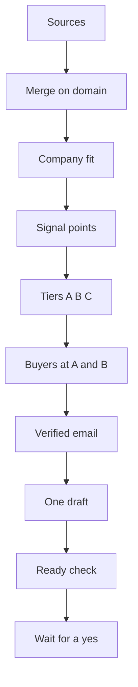

# Engine map

Fictional example. No real companies or people.

## Coverage path and signal path

The coverage path gives every company that passed fit a slow touch inside the weekly cap. The signal path moves a fresh strong signal up the rank. A company that failed fit stays held even when the signal is strong. Tier C does not buy a contact. Both paths use the same ready check, and neither path sends by itself.
